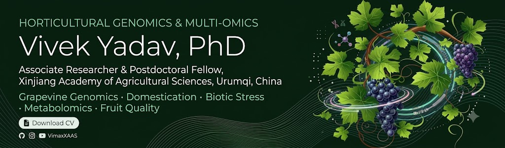

  

---

### 🧬 About Me

I investigate the genetic architecture, evolutionary history, and stress adaptation of horticultural crops with a primary focus on **grapevine genomics (*Vitis vinifera*) and watermelon (*Citrullus lanatus*)**. My work integrates **haplotype-resolved genome assembly, transcriptomics, untargeted metabolomics, and functional genetics** to dissect disease resistance and fruit quality traits.

| Research Domain | Key Focus & Scientific Questions |
| :--- | :--- |
| 🍇 **Grape Genomics & Domestication** | Haplotype-resolved genome assembly, resequencing, and evolutionary history of ancient Xinjiang cultivars (e.g., 'Munage'). |
| 🍄 **Biotic Stress & Pathogenesis** | Phytohormonal crosstalk, transcriptional reprogramming, and rootstock-enhanced resistance against *Botrytis cinerea* and powdery mildew. |
| 🧪 **Multi-Omics & Berry Quality** | Untargeted metabolomics and transcriptomics uncovering berry cracking mechanisms (*VviWRKY50*–*VviPME39*), sugar dynamics, and raisin dehydration. |
| 🧬 **Candidate Gene Mining** | Functional characterization of Trihelix, Dirigent, BPC, and Laccase gene families for stress tolerance. |

> **Academic Metrics (Google Scholar):** **2,840+ Citations** | **h-index: 22** | **i10-index: 27** | **80+ Verified Peer Reviews**

---

### 📄 Selected Publications

#### 2026
* **Corresponding author.** Cheng, Y., **Yadav, V.**, and Zhang, C. *VviWRKY50*-Mediated Repression of *VviPME39* Underpins Gibberellin-Induced Resistance to Fruit Cracking in Grape. *Plant, Cell & Environment*. [doi:10.1111/pce.70720](https://doi.org/10.1111/pce.70720)
* **First author.** **Yadav, V.**, Wang, H., Zhang, F., et al. Rootstock-enhanced gray mold resistance through phytohormonal crosstalk and transcriptional reprogramming. *Plant Physiology and Biochemistry* 236:111430. [doi:10.1016/j.plaphy.2026.111430](https://doi.org/10.1016/j.plaphy.2026.111430)
* **Corresponding author.** Zhang, C., Lyu, S., **Yadav, V.** Multi-Variety Metabolomic Profiling Uncovers Conserved and Divergent Metabolites Underlying Antioxidant Potential in Grape Dehydration. *Applied Food Research*, 102284. [doi:10.1016/j.pmpp.2025.102628](https://doi.org/10.1016/j.afres.2026.102284)
* **Corresponding author.** Zhang, C., Lyu, S., **Yadav, V.** Untargeted Metabolomics Reveals Color-Dependent Nutritional Variation in Raisins: Insights into Composition and Antioxidant Capacity. *Antioxidants* 15:401. [doi:10.1016/j.pmpp.2025.102628](https://doi.org/10.3390/antiox15030401)

#### 2025
* **First author.** **Yadav, V.**, Zhang, F., Wang, H., et al. Identification of trihelix transcription factors in grapevine and expression dynamics in response to biotic stress and hormone treatment. *Physiological and Molecular Plant Pathology* 137:102628. [doi:10.1016/j.pmpp.2025.102628](https://doi.org/10.1016/j.pmpp.2025.102628)
* Zhong, H., Shi, X., Zhang, F., ..., **Yadav, V.**, ..., Hua Xiao. Haplotype-resolved assemblies provide insights into genomic makeup of the oldest grapevine cultivar (Munage) in China. *Horticulture Research*, uhaf274. [doi:10.1093/hr/uhaf274](https://doi.org/10.1093/hr/uhaf274)

#### 2024
* **First author.** **Yadav, V.**, Zhong, H., Patel, M.K., et al. Integrated omics-based exploration for temperature stress resilience: An approach to smart grape breeding strategies. *Plant Stress* 11:100356. [doi:10.1016/j.stress.2024.100356](https://doi.org/10.1016/j.stress.2024.100356)
* **Corresponding author.** Wang, H., Zhong, H., ..., **Yadav, V.** Identification of Grape Laccase Genes and Their Potential Role in Secondary Metabolite Synthesis. *International Journal of Molecular Sciences* 25(19):10574. [doi:10.3390/ijms251910574](https://doi.org/10.3390/ijms251910574)

<b>📚 View More Publications (2020–2023)</b>

 

* **Yadav, V.**, Wang, Z., Yanliang, G., Zhang, X. (2022). Comparative transcriptome profiling reveals the role of phytohormones and phenylpropanoid pathway in early-stage resistance against powdery mildew in watermelon. *Frontiers in Plant Science* 13:1016822.
* **Yadav, V.**, Sarker, A., et al. (2022). Integrated biorefinery approach to valorize citrus waste. *Chemosphere* 293:133459.
* **Yadav, V.**, Wang, Z., et al. (2021). Comparative Analysis, Characterization and Evolutionary Study of Dirigent Gene Family in Cucurbitaceae. *Genes* 12(3):326.
* **Yadav, V.**, Wang, Z., et al. (2020). Phenylpropanoid Pathway Engineering: An Emerging Approach towards Plant Defense. *Pathogens* 9(4):312.

---

### 📖 Guest Editor & Special Issues

* **MDPI International Journal of Molecular Sciences (IJMS):**  
  *Guest Editor:* [*Genetic and Molecular Diversity Underlying Metal Tolerance and Homeostasis in Plants*](https://www.mdpi.com/journal/ijms/special_issues/4T6M6NFR3L)
* **MDPI Horticulturae:**  
  *Guest Editor:* [*Challenges for Berry Crop Production and Pathogens Protection*](https://www.mdpi.com/journal/horticulturae/special_issues/335Y3188G0)
* **New Zealand Journal of Crop and Horticultural Science (Wiley):**  
  *Guest Editor:* [*Embryo, Stone, and Fruit Development in Crops: Integrating Breeding, Genetics, and Multi-Omics*](https://www.royalsociety.org.nz/news/nzjchs-fruit)

---

### 🏛️ Professional Memberships

* 🌿 **ISHS** — International Society for Horticultural Science
* 🌱 **ASHS** — American Society for Horticultural Science
* 🇮🇳 **HSI** — Horticultural Society of India *(Life Member)*
* 🥗 **ISVS** — Indian Society of Vegetable Science *(Life Member)*
* 🇸🇪 **SPPS** — Scandinavian Plant Physiology Society (Sweden)

---

### 📬 Contact & Location

* **Office:** Institute of Fruit and Vegetable Crops, Xinjiang Academy of Agricultural Sciences, Urumqi, China
* **Email:** [vivekyadav@nwafu.edu.cn](mailto:vivekyadav@nwafu.edu.cn) | [vivek-yadav94@outlook.com](mailto:vivek-yadav94@outlook.com)
* **Personal Academic Site:** [vimaxxaas.github.io](https://vimaxxaas.github.io/)
